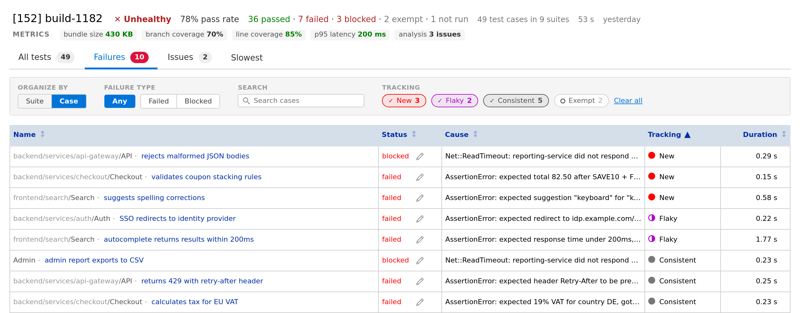

[](https://github.com/testspace-com/setup-testspace/actions/workflows/ci.yml)

# Setup Testspace

This [GitHub Action](https://github.com/features/actions) installs and configures the Testspace client, so a workflow can publish its test results, code coverage and static analysis to [Testspace](https://www.testspace.com) with one command.

- Reads JUnit XML (which most test frameworks write, some with a reporter), NUnit, xUnit.net and Visual Studio TRX, plus coverage and static analysis files.
- Runs on Linux and macOS runners (x86-64 and arm64) and Windows runners.

See the results of a real workflow in the [live demo](https://s2.testspace.com/projects/EXAMPLE:RESULTS). It needs no account.

## Usage

```yml
steps:
  - uses: actions/checkout@v4
  - uses: testspace-com/setup-testspace@v1
    with:
      domain: ${{ github.repository_owner }}
      token: ${{ secrets.TESTSPACE_TOKEN }}   # private repositories only
  # ... build and run your tests ...
  - name: Publish results to Testspace
    run: testspace "test-results/*.xml" coverage.xml
    if: always()
```

`if: always()` publishes the results when tests fail, which is when they matter most.

### Inputs

| Input | Required | Description |
|---|---|---|
| `domain` | yes | Your Testspace Organization's name, the subdomain you [signed up](https://help.testspace.com/get-started/sign-up) with (`.testspace.com` is optional). |
| `token` | private repositories | An [access token](https://help.testspace.com/organization/users-and-permissions#account) or a Project's [push token](https://help.testspace.com/projects/connected#push-token), stored as a repository secret. Public repositories don't need one. |
| `config-args` | no | Extra arguments for the client's `config` command (see the [client reference](https://help.testspace.com/reference/testspace-client)). |

To pin the client's version, set the `TESTSPACE_CLIENT_VER` environment variable. On pull requests, Testspace reads the pull request's number with `jq`, which GitHub's hosted runners include; on a self-hosted runner without it, the action shows a warning.

### Jobs, matrix builds and several workflows

Each job pushes its own files, and Testspace combines everything published for the same commit into one result. Give each job's results their own folder so they stay apart:

```yml
- run: testspace "[${{ matrix.os }}]test-results/*.xml"
  if: always()
```

See [Matrix](https://help.testspace.com/publish/push-data-add-to-ci#matrix) and the [GitHub Actions setup](https://help.testspace.com/publish/push-data-add-to-ci#github-actions) in the help, and [what can be published](https://help.testspace.com/publish/push-data-results#file-content).

## What you get



- **Failure Tracking:** every failing test is tracked from one run to the next, marked New, [Flaky](https://help.testspace.com/results/failures#flaky) or Consistent, until it passes again.
- **Health:** each result is [Healthy or Unhealthy](https://help.testspace.com/results/health) against the checks you set, posted as a status check on the commit and pull request.
- **Every branch and pull request** gets its own results, with each test's history across them.
- **Trends:** a [monthly view](https://help.testspace.com/results/trends) of whether quality is getting better, with what needs attention.

More: [Automated test results](https://www.testspace.com/test-results-dashboard) · [Visualizing GitHub Actions test results](https://www.testspace.com/blog/visualizing-test-results-with-github-actions) · [Publishing overview](https://help.testspace.com/publish/overview)

## Contributing

Contributions are welcome; see the [Contribution Guide](CONTRIBUTING.md).

## License

Released under the [MIT License](LICENSE).
